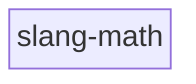

# Architecture

The checked-in architecture contract for slang-math (the check-arch reflexion
gate). slang-math is a flat, single-module header library — there is no layer
stack to enforce. The architecture contract is the one that applies: **no
cyclic `#include` dependencies** (file-level strongly-connected components;
partial/deferred cycles that happen to compile are still a violation).
slang-math is the family root — nothing downstream may ever be included.

<!-- check_arch: diagram BEGIN -->
### the layers



### layer slang-math - the modules


<!-- check_arch: diagram END -->

## The machine contract

```arch
scan: include
extensions: .hpp, .h
exclude: build, _deps, .git
unclassified: error
external:
forbidden: harmonia, aether, theia, hyperion
quotes_relative: true
repo_fallback: false
cycles: true
namespace_root:
namespace_module:
namespace_require:
unresolved: info

layer slang-math

module slang-math in slang-math
```
