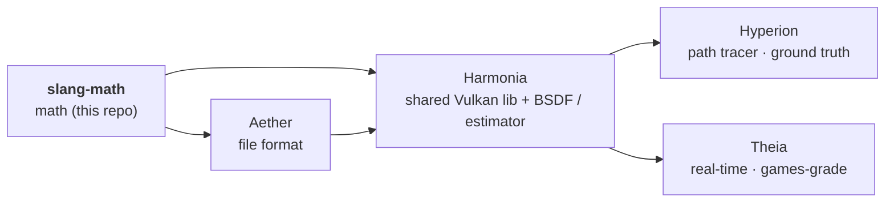

# PLAN — slang-math

**Living source of truth for outstanding work.** Shipped items are removed from the work
lists; the shipped record is the *Baseline* below and `git log`. Only outstanding work is
tracked here.

**How to read this plan** — *human / PM:* *How to continue* is the prioritized next-up list.
*AI agent picking up work:* read `AGENTS.md` (orientation, enforced conventions) → *How to
continue* (your task) → *Governance* (definition of done + guardrails) **before editing**.

## Context

slang-math is the header-only C++20 math substrate of a five-repo rendering pipeline:

The family's goal is OpenPBR 1.1.1 as the single material standard, with Theia converging to
Hyperion's unbiased ground truth. slang-math's part: a complete, consistent, standalone
math package with Slang/HLSL naming parity (see `AGENTS.md` for the enforced policies).
Sibling plans: `Aether/PLAN.md`, `Harmonia/PLAN.md`, `Hyperion/PLAN.md`, `Theia/PLAN.md`
in the sibling clones.

## At a glance

- **Release:** v0.6.0 (tag-synced with GitHub) - SM1 common-function batch
  (scalar+vec `sign`/`frac`/`rsqrt`/`step`; vec-only `floor`/`ceil`/`trunc`/`round`/`fmod`/
  `fma`/`exp2`/`log2`/`log10` + `pow(V,V)`; classification `any_nan`/`any_inf`/`all_finite`;
  80/80 ctest).
- **Prior:** v0.5.0 - SM4 transform builders
  (`trs` / `ortho` / `inverseOrtho` with round-trip tests; 70/70 ctest).
- **Prior:** v0.4.0 - `sm::saturate` (canonical Slang/HLSL
  clamp-to-[0,1], scalar + all float vector sizes) + SM-02 (`translate` unrolled rows
  looped). The SM6 shader-migration gate downstream is now satisfied.
- **Quality gates:** blocking lint (Q2-Q6) + **blocking coverage CI** (`coverage (Q1)`
  job, llvm-cov: 90.74% regions / 86.68% lines).
- **Next:** SM2 trig + geometric completion → **v0.7.0** (minor, per the incremental
  release policy), then SM3. SM6 adoption lands downstream against released tags
  (Harmonia's slice is already swept — zero migratable sites; the remainder was
  upstream-blocked until now and unlocks with v0.6.0). X-01 (canonical `check_tidy.py`)
  deferred - possibly a separate quality repo later.
## How to continue

### slang-math function-parity track (SM)

Close the gap between slang-math and the HLSL/Slang intrinsic vocabulary it mirrors, per this
repo's "complete, consistent, standalone package" type-set policy (AGENTS.md). Grounded in
downstream evidence: shader `saturate` has 99 call sites vs ~40 hand-rolled
`std::clamp(x,0,1)` host sites (Harmonia 26, Aether 12, Theia 1) plus a local `clamp01()`
(`Harmonia/src/harmonia/pipeline/SceneOutputCopyPass.cpp:36`); shader `isfinite` has 29 sites
and Harmonia's dead hand-rolled `Math::isNanOrInf` has been deleted (H-04); `cos`
is the only trig function shipped, so
downstream runs per-component `std::sin`/`std::cos`/`std::atan2` code
(`Theia/src/theia/renderer/CameraController.hpp`, Harmonia's `IblProbe.cpp`/`Light.cpp`);
`rsqrt` is hand-mirrored as `1/std::sqrt` in two spots (`Hyperion/tests/unit/test_bsdf.cpp:491`,
`Harmonia/tests/unit/test_math.cpp:73`). Library comparison: glm-parity items are folded into
SM3/SM4 (`determinant` 4×4, `toQuaternion`, `ortho`, `trs`); DirectXMath's SIMD focus is out
of scope by design (slang-math is header-only and constexpr-friendly).

| ID | Task | Deps | Status |
|----|------|------|--------|
| SM1 | **Common-function batch** — scalar+vec `sign`/`frac`/`rsqrt`/`step` (collision-free names); vec-only `floor`/`ceil`/`trunc`/`round`/`fmod`/`fma`/`exp2`/`log2`/`log10` + per-component `pow(V,V)` (C-library collisions — scalar stays `std::`); classification as **`any_nan`/`any_inf`/`all_finite`** (`isnan`/`isinf`/`isfinite` are C-runtime-owned: UCRT global unconstrained templates collide even for vector args — the documented Slang-naming fallback). 10 contract tests; 80/80 ctest. | — | **done (v0.6.0)** |
| SM2 (v0.3.0) | **Trig + geometric completion** — `sin`/`tan`/`asin`/`acos`/`atan`/`atan2` (vec), `faceforward`, `refract` (zero-vector-on-TIR). | — | backlog |
| SM3 (v0.3.0) | **Matrix/quaternion completeness** — `determinant(float4x4)` (cofactor expansion; 2×2/3×3 exist), `v*M` row-vector ops for `float2x2`/`float3x3` (float4x4 has it, `float4x4.hpp:70`), `toFloat3x3(quaternion)` (symmetry with `toFloat4x4`), `toQuaternion(float3x3)` (Shepperd's method; TRS-decompose prerequisite for the family's animation track). | — | backlog |
| SM4 | **Transform builders** — `trs(t, q, s)` compose (the `Harmonia/src/harmonia/scene/Geometry.cpp:97` T·R·S pattern; feeds the node-hierarchy work NH2 in Harmonia/PLAN.md), `ortho` + `inverseOrtho` (RH ZO depth, symmetric with the `perspective`/`inversePerspective` pair). | — | **done (v0.5.0)** |
| SM5 | **Docs + release per batch** — AGENTS.md `float_vec` enumeration + the scalar/vector collision rule refreshed with SM1; README tables track the shipped set. Batches release incrementally as minors: v0.5.0 (SM4), v0.6.0 (SM1), v0.7.0 planned (SM2). | per batch | **done (v0.6.0)** |
| SM6 | **Downstream migration** (post-tag) — replace hand-rolled downstream code with the new functions (saturate sites, dead `Math::isNanOrInf`, duplicate `kPi` constants, `IblProbe` hand-rolled `Mat3` → `sm::float3x3`, `Geometry.cpp` TRS → `sm::trs`, test-mirror `rsqrt`/`saturate` cleanup). **Tracked in the downstream repos** — Aether/Harmonia/Hyperion/Theia each carry their slice in their own PLAN.md; this repo's part ends at tagging v0.3.0. | SM5, v0.3.0 tag | backlog |

The SM batches ship as **incremental minors** per the family release policy (v0.5.0 SM4,
v0.6.0 SM1, v0.7.0 SM2 planned) — not hoarded into one release; SM6 is the downstream
follow-up (tracked in the renderers' own PLANs).

**Design decisions (locked):** naming = HLSL/Slang spelling (`frac`, `fma`, `rsqrt` — never
the glm `fract`/`inversesqrt`; no aliases per the repo's one-canonical-name rule). Scalar
overloads only where `std::` has no equivalent (`saturate`, `sign`, `frac`, `rsqrt`, `step`) —
scalar floor/round/trig stay with `std::`, matching the existing `abs`/`sqrt`/`cos` vector-only
precedent and avoiding `using namespace` ambiguity (probe-verified: `<cmath>` injects global
float overloads). Vector ops are `float_vec`-generic
(float2/3/4 inherit automatically). The classification helpers ship as `any_nan`/`any_inf`
(true if **any** component matches) and `all_finite` (true only if **all** components are
finite; validation semantics; vector-only) — the Slang spellings `isnan`/`isinf`/`isfinite`
are unshippable: the UCRT declares unconstrained global templates that collide with any
`sm::` overload of those names (probe-verified, clang-cl / MSVC 14.51).
Documented edge semantics: `sign(0) == 0`; `frac(x) = x − floor(x)`; `fmod` truncated (sign
follows dividend); `round` half away from zero; `refract` returns the zero vector on TIR;
`toQuaternion` requires an orthonormal rotation matrix.

## Governance

**Definition of done (per change):** `ctest` green **+** warning-clean build (strict
warnings-as-errors: clang-cl `/W4 /WX /permissive- /Zc:__cplusplus`, Clang/GNU
`-Wall -Wextra -Werror -Wpedantic`; a compiler warning is a build failure — fix the cause,
never silence it). Every new function carries a round-trip or identity test (repo contract).
**Per release:** the above plus `verify-full` (verify + format-check + clang-tidy + cppcheck).

**Guardrails:**

- Naming conventions and the type-set policy in `AGENTS.md` are enforced — do not regress.
- API additions are a minor version bump; breaking renames coordinate with downstream repos
  (migrate all call sites in Aether/Harmonia/Hyperion/Theia in the same change).
- Fix bugs at once — root-caused and patched in the same change. Deferral is not an
  acceptable resolution for a known defect.
- Solve directly, never defer: divergences are root-caused and fixed in code, not
  documented away.
- Tags are always pushed to GitHub — after any local tag, verify `git ls-remote --tags
  origin` == `git tag -l`. slang-math tags **first** in the family release order
  (slang-math → Aether → Harmonia → Theia/Hyperion); downstream repos bump their
  FetchContent `GIT_TAG` pins in their own release commits.
- Commit per-repo; push only on explicit OK.
- Living document — done work is removed from this file; the record is the Baseline and
  `git log`.

## Baseline

- **v0.6.0** (current): **SM1 common-function batch** - scalar+vec `sign`/`frac`/`rsqrt`/`step`; vec-only `floor`/`ceil`/`trunc`/`round`/`fmod`/`fma`/`exp2`/`log2`/`log10` + per-component `pow(V,V)`; classification `any_nan`/`any_inf`/`all_finite` (UCRT name-collision fallback, probe-verified). 10 new contract tests; 80/80 ctest; AGENTS.md enumeration + collision rule refreshed.
- **v0.5.0**: **SM4 transform builders** - `trs(t, q, s)` compose, `ortho` + `inverseOrtho` (RH ZO), 6 round-trip/identity tests; 70/70 ctest, arch gate clean.
- **v0.4.0**: **`sm::saturate`** (canonical Slang/HLSL clamp-to-[0,1], scalar + all float vector sizes) + SM-02 (`translate` unrolled rows looped) + the family quality gates (blocking lint, blocking coverage CI: 90.74% regions / 86.68% lines). 64/64 ctest.
- **v0.3.2**: **Q1 coverage lane.** `<SLANGMATH>_COVERAGE` CMake option
  (clang: `-fprofile-instr-generate -fcoverage-mapping`, gcc: `--coverage`; clang-cl links
  via `-fuse-ld=lld` for the profile runtime) + `tools/coverage.py` script
  (instrumented configure/build, ctest with `LLVM_PROFILE_FILE`, profdata merge, llvm-cov
  report). Verified end-to-end: 61/61 tests, **90.65% line coverage** on the headers.
  AGENTS documents the lane and the architecture-gate contract (vendored
  engine, orphan-free).

- **v0.3.1**: **architecture gate.** `tools/check_layers.py` (ctest
  `test_layers`, label `analysis`) — slang-math is a flat single-module header library, so
  the gate enforces the one architecture contract that applies: **no cyclic `#include`
  dependencies** (file-level SCC detection; partial/deferred cycles that merely compile
  still fail). AGENTS documents the gate. 62/62 ctest on Windows; Linux suite green.
- **v0.3.0**: spec-grounded component aliases (`float2` `r`/`g`; `float3`/`float4`
  `r`/`g`/`b`(/`a`) — the Slang swizzle vocabulary per the user guide's "xyzw and rgba only";
  `stpq` deliberately unsupported) with the scoped GCC `-Wpedantic` justification pragma;
  `-Wpedantic` compliance; dual-OS CI (`windows-latest` + `ubuntu-26.04` — build + the
  62-test suite on both); CMakePresets (win), the classified `check_tidy.py` / ctest
  `test_tidy` lane, sanitizer option, deterministic host FP; PLAN.md introduced;
  README type/function tables refreshed.
- **v0.2.1**: generic vector operators (`template<vec V>`), consumed by all four downstream repos.
- **v0.2.0**: the established type set (float2/3/4, uint2/3/4, float2x2/3x3/4x4, quaternion),
  row-major layout, RH+ZO-only transform builders.
- Earlier history in `git log`.
